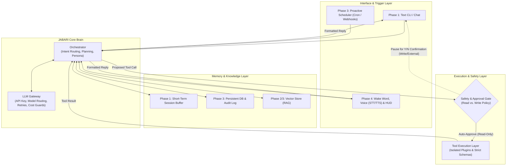
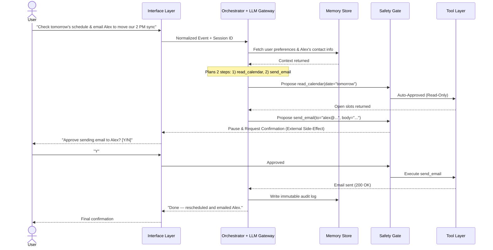
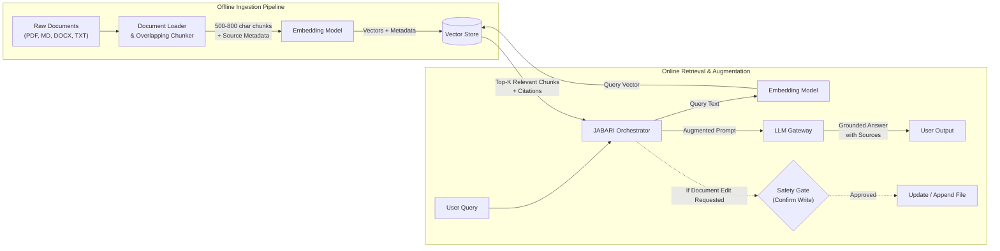

# JABARI — Personal Automation Assistant

**JABARI** is a modular, JARVIS-inspired personal automation assistant designed to be built incrementally. Rather than constructing a monolithic script, JABARI separates **decision-making** from **execution**, places a mandatory **Safety & Approval Gate** between them, and supports **Retrieval-Augmented Generation (RAG)** for reading and augmenting private documents.

---

## 1. Incremental Build Roadmap

JABARI is structured as a modular spine so each phase plugs into the existing core without requiring a rewrite:

| Phase | Name | Modules Added | Capabilities Unlocked |
| :--- | :--- | :--- | :--- |
| **Phase 1** | **The Core Brain (MVP)** | Text CLI Adapter, LLM Gateway (API Key), Orchestrator, Short-Term Memory | Converses in text with a consistent JABARI persona and retains current session context. |
| **Phase 2** | **Hands & Safety Gate** | Tool Registry, Safety/Approval Gate, Starter Tools, RAG (Read) | Executes real tasks (search, calendar, local files, document Q&A) while pausing for confirmation on risky actions. |
| **Phase 3** | **Memory & Proactivity** | Persistent Database, Audit Log, Background Scheduler, RAG (Write) | Remembers preferences across restarts, logs all actions, edits documents safely, and sends proactive briefings. |
| **Phase 4** | **The JARVIS Interface** | Wake Word ("Hey Jabari"), Voice Pipeline (STT/TTS), Live Web/Desktop HUD | Hands-free voice interaction paired with a real-time status dashboard. |

---

## 2. System Architecture Diagram

> **Note:** On GitHub, hover over any diagram below to pan, zoom, and inspect the architecture interactively.

---

## 3. Core Architectural Principles

### LLM Gateway (Adapter Pattern)
All external LLM API calls route through a single internal wrapper (`llm_client`) rather than scattering SDK calls across the codebase:
* **Model Routing:** Use fast, low-cost models for intent classification and formatting, reserving stronger models for multi-step planning.
* **Secret Isolation:** Store API keys in `.env` (excluded via `.gitignore`). Keep the LLM API key separate from tool credentials (Gmail, Calendar, etc.).
* **Cost & Loop Guards:** Enforce a hardcoded `max_steps` cap (e.g., 5 iterations) per request, prune old conversation turns, and set hard monthly billing caps with the API provider.
* **Resilience:** Implement exponential backoff (`1s`, `2s`, `4s`) for `429` rate limits and timeouts, with graceful fallback messages.
* **Privacy Boundary:** Never pass raw credentials or OAuth tokens into LLM prompts. The Orchestrator passes *parameters* only; the Tool Layer injects authentication locally at runtime.

### Safety & Approval Gate
Every tool call is classified before execution:
* **Read-Only Actions** (checking calendars, searching documents, fetching weather) pass automatically.
* **State-Changing / External Actions** (sending emails, modifying or deleting files, running terminal commands) pause execution and prompt the user for explicit confirmation.

---

## 4. Request Lifecycle (Sequence Diagram)

This diagram illustrates how JABARI handles a multi-step request involving both a **read-only** action and a **gated external** action:

---

## 5. RAG Architecture (Document Reading & Augmentation)

JABARI's RAG system is split into an **Offline Ingestion Pipeline** (indexing files) and an **Online Retrieval & Augmentation Pipeline** (answering questions and safely editing documents).

### RAG Design Rules
1. **Mandatory Source Metadata:** Every chunk stores its filename, page number, and section title so JABARI can cite exact sources.
2. **Read vs. Write Separation:** Document querying (`search_docs`) is registered as a read-only tool (auto-approved), while document modification (`update_doc` / `create_doc`) is a write tool gated by user confirmation.
3. **Grounded Fallback:** If similarity scores fall below the confidence threshold, JABARI explicitly states the information was not found in the indexed documents rather than hallucinating.

---

## 6. Phase 1 MVP Scope (Starting Point)

Before adding tools, databases, or voice, Phase 1 focuses on four decoupled modules:
1. **`interface`**: Simple text CLI loop for input/output.
2. **`llm_gateway`**: Single API wrapper with `.env` key loading, retries, and token limits.
3. **`orchestrator`**: Injects JABARI's system prompt and manages the conversation loop.
4. **`memory`**: Lightweight in-memory list retaining the last 10–15 turns.